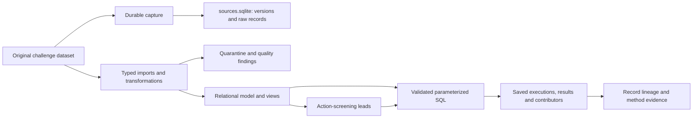

# Architecture and reproducibility

## Data flow



Capture commits complete input versions before typed modelling. The analytical DB
is built temporarily and replaces the destination after validation. Raw snapshots,
entities, evidence and saved results form one build snapshot. The independent
archive retains earlier source versions.

Export CSV/validation files are written during builds, **not collectively published
atomically**. If a build fails, the old DB remains; inspect/regenerate exports
before sharing them.

## Boundaries and paths

- This folder owns code, SQL/configuration, docs, tests and outputs.
- The challenge package supplies original data, method docs and reference code.
- `tools/paths.py` resolves the model folder from its location. Default data is
  the neighboring dataset's `data/`; `APETIT_DATA_DIR` overrides it.
- Tool defaults are independent of process working directory. Documentation assumes
  this model folder as cwd for convenience.
- Code hashes use names such as `tools/nature_queries.py` or `dataset/tools/…` for
  original reference code. Do not resolve them all against the repository root.
- Source paths are relative to challenge `data/`, including known `../docs/` paths.

## Code map

| Component | Responsibility |
|---|---|
| `tools/paths.py` | Portable paths/code identities |
| `tools/check_environment.py` | Runtime/input preflight; optional build hash/FK check |
| `tools/capture_nature_sources.py` | Durable CSV/GeoJSON/Markdown source versions |
| `tools/build_nature_model.py` | Typed imports, quarantine, farming joins, stages and validation |
| `tools/nature_quality.py` | Evidence-backed review candidates and field scopes |
| `tools/nature_climate.py` | Monthly weather, grid assumptions, complete-window summaries |
| `tools/nature_sourcing.py` | ERP, units/reference FX and sourcing quality candidates |
| `tools/nature_masters.py` | Sites/factors, reference resolution, coordinate review |
| `tools/nature_frameworks.py` | Local sections, source registry and method evidence |
| `tools/nature_scenarios.py` | Scenario/price/event/report context and action screens |
| `tools/nature_queries.py` | Parameter validation and saved execution/contributor/review context |
| `tools/query_nature_model.py` | Query CLI and lineage export |
| `tools/build_nutrient_inputs.py` | Read-only-base input experiments with peer/proxy sensitivity, leave-farm-out checks and self-contained evidence |
| `tools/build_nutrient_losses.py` | Matching-base catchment pilot, field loss/delivery/retention separation, input/method stress cases and mass reconciliation |
| `tools/create_snapshot.py` | Manual SQLite backup; not state migration |
| `tools/database_artifact.py` | Optional local compressed export/restore; artifacts are ignored, not shared via Git |
| `tools/explore_farming.py` | Original reproducible farming profile |
| `tools/build_farming_2025.py` | Shared normalizer and optional focused 2025 export |
| `tools/test_*.py` | Unit/integration, lineage, aggregation and handover checks |

The current builder does not consume the 2025 export. That tool's name reflects
the earlier milestone, not the database's temporal scope.

## Model definitions

- `schema.sql`: base farming/nature, lineage and result structures.
- `extensions.sql`: quality, climate, sourcing and query definitions.
- `decision_context.sql`: masters, evidence, scenarios and action screens.
- `queries/catalog.json`: questions, grains, parameters/defaults.
- `queries/*.sql`: results and explicit contributors.
- `schema.sql:nutrient_input_context`: field/year/input coverage classification,
  summarized by query 22 with scoped quality context; no input imputation.
- `NUTRIENT_INPUT_POLICY.md`: versioned draft coverage/input treatment policy,
  included in build hashes; scientific review remains pending.
- `nutrient_input_policy.json`, `NUTRIENT_MODEL_INPUT_POLICY.md`: provisional
  0.2.0 model-input experiment configuration and interpretation. Separate from
  the coverage classifier; not an approval or a change to original values.
- `nutrient_inputs.sql`: independent per-run artifact schema. Unique
  field/year/input/variant candidates link to copied donor/target source evidence,
  component inputs and quality context. No base DB writes or state migration.
- `nutrient_loss_model.json`, `NUTRIENT_LOSS_METHOD.md`, `NUTRIENT_LOSS_EVIDENCE.json`:
  uncalibrated loss equations, assumed modifiers, stress cases and evidence roles.
- `nutrient_loss.sql`: extends a copy of an input artifact with driver snapshots,
  extra climate/catchment evidence, used input IDs and field loss/delivery results.
- `knowledge_map.json`: curated method/evidence roles and interpretation.
- `action_screening_rules.json`: five versioned predicates/prerequisites.

Read the [dictionary](model/nature/DATA_DICTIONARY.md) before joining. Field/year,
farm/crop/year, grid/scenario/month and catchment/year are different grains. A
query that runs is not automatically a valid scientific calculation.

## Reproduction

From this folder:

```bash
python3 tools/check_environment.py
python3 tools/build_nature_model.py
python3 -m unittest discover -s tools -p 'test_*.py'
python3 tools/check_environment.py --verify-existing
```

Optional earlier artifacts:

```bash
python3 tools/explore_farming.py
python3 tools/build_farming_2025.py
```

Default `decisions` captures all 30 inputs/reference-code hashes, executes 22
questions and writes validation/quality counts. Earlier cumulative stages are for
investigation and are not the complete handover baseline.

Database binaries are not tracked. A fresh clone builds them from the original
tracked challenge package. Local export/restore utilities remain available for
manual state transfer, but no compressed artifact or manifest is supplied in Git.

Stable inputs/code should produce stable domain data and default result values.
DB bytes, timestamps, UUIDs and backup hashes can differ. See the handover
verification report for commands actually run, not an assumption of byte-identical builds.

## Limits for future services

SQLite REAL is floating point; raw values/units remain available. Geometry is JSON
without spatial indexes or full topology checks. Lineage is conservative record
ancestry plus column rules; arbitrary SQL lacks automatic per-cell provenance.

No network API, multi-user approval service, background jobs or automatic correction
application exists. Rebuilds do not migrate human state. Read [ROADMAP](ROADMAP.md)
before turning the prototype into a shared service.

Input experiments verify the base and use a read-only SQLite transaction. They
create new directories under ignored `analysis/nature/input_runs/`, refusing to
overwrite previous runs. Their metadata includes the base build/source versions,
current reviews/proposals and experiment code/config hashes. Raw evidence,
recursive dependencies, column rules, transformations and method documents are
copied into `inputs.sqlite`; later base rebuilds cannot change that copy. This
preserves experiment evidence, not an approved-review migration workflow. Small
tracked sensitivity/evaluation CSVs are snapshots copied from a completed run;
the large input artifacts stay local and are reproduced from the documented CLI.

Loss pilots require input/source-build/year/review-version agreement. They copy
the input artifact with SQLite backup and add the chosen catchment's driver
snapshots and climate/normal/mapping/catchment ancestry. Source data and the input
run remain read-only. Historical annual rain uses complete 1991–2020 grid normals;
the pilot accepts target years 2021–2026. Each field/nutrient/input-policy/donor-
point/method-case result links to its required inputs. Catchment scope totals are
NULL when any required field result is unavailable. Whole-catchment monitoring
is labelled context and never used to set parameters. Large pilots and full
contribution CSVs stay ignored in `analysis/nature/loss_runs/`; small central-case
field CSVs and full grouped summaries can be tracked. Passing reconciliation is
an engineering check, not scientific calibration or independent evaluation.
