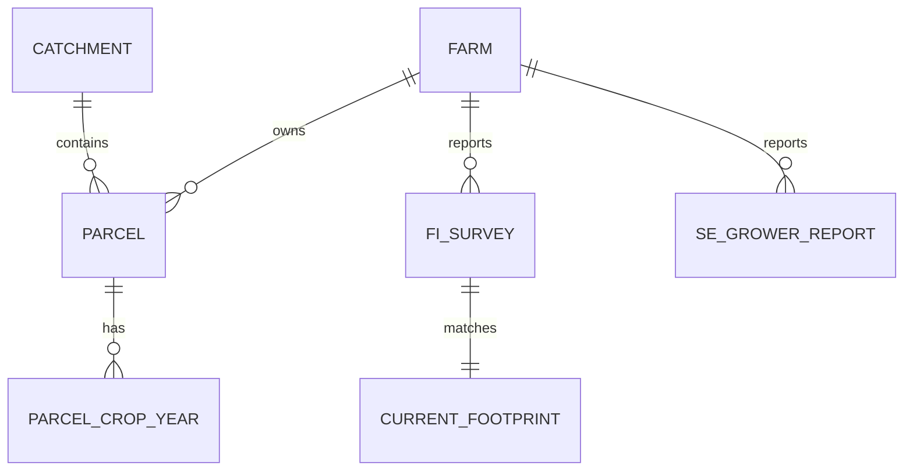

# Exploring `03_farming` for Track D

This is the initial data model for the question: **Which farming areas should Apetit
prioritise for protecting water and biodiversity?** It describes the supplied files;
it does not yet estimate nutrient losses or rank catchments.

Reproduce the profile from the model-package folder (`traceflow/nature_model/`) with Python 3 (no dependencies):

```bash
python3 tools/explore_farming.py
```

The generated [profile.json](profile.json) contains column values, numeric ranges,
missing values, key checks, join checks, annual observation coverage and an example join.
The profiler leaves all source files unchanged. Keys below are unique in this package;
they are proposed constraints for a future curated model, not constraints enforced on the CSVs.

## 1. What one row means

The *grain* of a table means what a single row describes. Different grains are the
most important thing to understand before joining these files.

| File | One row describes | Observed unique key | Rows | Years |
|---|---|---|---:|---|
| `parcel_crop_history_and_plan.csv` | A crop assignment to one field in one year | `parcel_id, year` | 284,260 | 2012–2031 |
| `farm_survey_fi.csv` | A Finnish farm's report for one crop in one year | `survey_id`; also `farm_id, crop, year` | 3,437 | 2012–2026 |
| `foodhills_odlingsdata_se.csv` | A Swedish grower's report for one crop in one year | `odlar_id, gröda, skördeår` | 2,683 | 2018–2026 |
| `current_calculator_footprints.csv` | An existing carbon-footprint result for a Finnish farm/crop/year | `farm_id, crop, year` | 3,437 | 2012–2026 |

All four files have zero blank cells and zero duplicate rows on the keys above.
That does **not** mean they contain complete or correct information: observations
can be missing as whole rows, and the package deliberately contains wrong values.

### Parcel crop history and plan: the spatial and temporal backbone

Fields: `parcel_id`, `farm_id`, `year`, `crop`, `catch_crop`, `status`.

- 14,213 fields × 20 years = 284,260 rows: every field has one assignment each year.
- `declared`: 2012–2026 (213,195 rows). `planned`: 2027–2031 (71,065 rows).
- Ten crops: barley, carrot, fallow, grass_ley, oats, pea, potato, spinach,
  turnip_rape and wheat. These include rotation crops outside Apetit's contract crops.
- `catch_crop` is a **field/year boolean**, unlike the survey's farm/crop/year share.
- Area, soil, drainage and catchment are not in this file. They come from `01_master/parcels.csv`.
- This is a crop-assignment table, not a field-level yield or fertiliser measurement table.

### Finnish farm survey: management and yield observations

The five reported crops are carrot, pea, potato, spinach and turnip_rape.

| Field(s) | Meaning and unit | Use for Track D |
|---|---|---|
| `survey_id`, `farm_id`, `crop`, `year` | Source identity and observation key | Trace an estimate to a report |
| `area_ha` | Reported area for this crop, hectares | Compare with mapped crop area; do not sum it after joining to fields |
| `soil_type_reported` | Farmer's mineral/organic soil classification | Compare with the uncertain soil map |
| `n_mineral_kg_ha`, `n_manure_kg_ha` | Nitrogen application rates | Inputs to nutrient-surplus/loss modelling |
| `p_kg_ha` | Phosphorus application rate | Input to phosphorus pressure modelling |
| `fertiliser_product` | Reported product | Management context |
| `yield_t_ha` | Harvested tonnes per hectare | Potential crop nutrient removal input, with crop-specific coefficients |
| `catch_crop_share` | Fraction from 0 to 1 of crop area with catch crops | Aggregate management evidence; compare with field assignments |
| `irrigated` | Irrigation flag | Management context; not a measured water volume |
| `diesel_l_ha`, `lime_t_ha`, `sprays` | Fuel, liming and plant-protection activity | Wider sustainability context; spray count is not pesticide mass or toxicity |

Reported soil class is not field truth. The soil map is also imperfect. Retain both
and their provenance rather than choosing one silently.

### Swedish Foodhills file: a different observation schema

Read as UTF-8, with **semicolon separator and decimal comma**. All crop labels in
this file are `Ärt (frysärt)` (freezing peas).

| Swedish field | Canonical field | Conversion |
|---|---|---|
| `odlar_id` | `farm_id` | Retain the existing `S…` identifier |
| `skördeår` | `year` | Integer |
| `gröda` | `crop` | Explicit mapping `Ärt (frysärt)` → `pea` |
| `areal_ha` | `reported_area_ha` | Decimal comma → decimal point |
| `levererad_mängd_ton` | `delivered_t` | Decimal comma → decimal point; tonnes |
| `kvävegiva_kg_ha` | `n_applied_kg_ha` | Retain as reported total N; no mineral/manure split supplied |
| `diesel_l_ha` | `diesel_l_ha` | Numeric |
| `bevattnad` | `irrigated` | `ja` → true, `nej` → false |

There is no phosphorus application, manure split, reported soil class, catch-crop
share or harvested yield in this schema. These fields should be **unknown**, not
zero. `delivered_t / reported_area_ha` is delivered tonnes per hectare; calling it
harvested yield would assume there were no rejections or other delivery differences.

### Current calculator footprints: a separate result

`carbon_footprint_kgco2e_per_kg` is a carbon intensity, not a nutrient loss.
All 3,437 keys match the Finnish survey exactly, one to one. The documented
calculator assumes mineral soil and excludes organic-soil emissions and land-use
change. Keep it as a versioned reference result; do not use it as a phosphorus,
nitrogen or biodiversity-impact factor.

## 2. How the tables connect



`FARM`, `PARCEL` and `CATCHMENT` live outside `03_farming`:

| Lookup | Key | Information added |
|---|---|---|
| `01_master/farm_registry.csv` | `farm_id` | Country, region, segment, listed contract crops |
| `01_master/parcels.csv` | `parcel_id` | Farm owner, hectares, location, soil, clay, slope, distance to water, drainage, soil P, buffers, catchment |
| `06_nature/catchments.csv` | `catchment_id` | Ecological status, retention, receiving-water type and P sensitivity |

Verified: every crop-history row matches a known field and farm, the field's farm
agrees with the history's farm, and every field matches a known catchment. All
Finnish and Swedish report keys have matching crop-history groups.

To attach management to fields, join using **all three** of `farm_id, crop, year`.
One observation may match several field/year rows. Use a left join so fields with
missing observations remain visible. Do not join on farm alone: it mixes years and crops.

**248 farms span multiple catchments.** Use each field's catchment; a farm-centre
coordinate or a single catchment per farm would misallocate pressure.

## 3. A concrete join and a real discrepancy

Finnish report `FS00009` describes farm `F0001`, peas, 2025:

- Reported area: **12.56 ha**; mineral N: **24.8 kg/ha**; P: **11.7 kg/ha**.
- The matching crop-history rows are fields `F0001-P09` and `F0001-P14`.
- Their mapped areas are **7.49 ha** and **1.82 ha**, both in catchment `CA28`.
- Their combined mapped area is **9.31 ha**, different from the report.

This is a review candidate, not an automatic correction. Across the history,
**85 survey records differ by more than 5%** from the mapped area for the same
farm/crop/year. The threshold is an exploration rule, not the official issue label.

If we provisionally apply the reported P rate to the mapped fields, the application
amount is `11.7 × 9.31 = 108.927 kg P`. This is **fertiliser applied**, not phosphorus
reaching water. A loss model and transport/retention model are still required.

Never repeat the full 12.56 ha or a whole-farm nutrient total on each field and
then sum it. Rates can be shared under an explicit uniform-management assumption;
totals must be allocated, with weights summing to one.

## 4. Coverage in the 2025 target year

For exploration, define a provisional contract field as a crop-history row whose
crop appears in that farm's `farm_registry.contract_crops`. This avoids treating
every rotation crop on a contract farm as Apetit sourcing. The registry is static;
confirm this selection against the task design and annual deliveries later.

| Country | Farm/crop combinations | With report | Mapped contract-crop area | Area with report |
|---|---:|---:|---:|---:|
| Finland | 392 | 283 (72.2%) | 7,953.17 ha | 5,795.06 ha (72.9%) |
| Sweden | 298 | 298 (100%) | 4,973.10 ha | 4,973.10 ha (100%) |

Finnish gaps require an explicit estimation policy. Swedish report coverage is
complete for this selection, but its **schema still lacks important nutrient inputs**.
Of all 14,213 fields, 2,518 lack a latest soil-P test (17.7%). These are missing
inputs to handle later, not grounds for dropping fields from a priority assessment.

## 5. Proposed model, independent of storage or interface

Keep the source CSVs immutable. A future database, API or MCP server can expose the
same entities without changing their meaning:

| Entity | Key | Design |
|---|---|---|
| `Farm` | `farm_id` | Registry identity and sourcing context |
| `Parcel` | `parcel_id` | Physical field attributes and `catchment_id` |
| `ParcelCropYear` | `parcel_id, year` | Crop, catch crop, declared/planned status; anchor for Track D |
| `FarmCropObservation` | `observation_id` | Typed FI/SE observation with farm/crop/year, source kind and nullable measurements |
| `FootprintResult` | Farm/crop/year + method version | Separate derived carbon result with boundary and unit |
| `ParcelNutrientEstimate` (future) | Field/year + model run | Field P/N losses, delivered loads, uncertainty and input lineage |
| `CatchmentAssessment` (future) | Catchment/year + model run | Aggregated delivered P/N and priority score/rank |

Use a source-derived observation ID (for example `fi:FS00009`); for Sweden use a
stable encoding of grower, crop and year. Do not require farm/crop/year uniqueness
across all future sources: two sources or revisions may describe the same season.
The present files happen to provide unique observations within each source.

Canonical types: IDs and crop codes as strings; year as integer; booleans parsed
explicitly (the string `False` is not a true boolean); measurements with documented
units and decimal precision. Null means unknown, and differs from a measured zero.
Store `source_file`, source record key/CSV line, original field, original value and
any transformation or correction. An estimated field value also needs the method,
model version, source observation, uncertainty and review status. Keep observed,
planned and estimated values distinguishable.

Do not merge reported area with mapped area, reported soil with mapped soil, or
farm-level catch-crop share with field-level catch-crop status into one ambiguous field.
The current parcel master has no effective dates: treating its attributes as valid
for every historical year is an assumption to record.

## 6. How this grows into Track D

The eventual calculation follows this chain:

```text
2025 field crop assignment + mapped field attributes
    + farm/crop/year management (observed or explicitly estimated)
    + weather exposure from 04_climate
        → estimated P and N lost from each contract field
        → delivery to water and catchment retention
        → sum delivered kg by catchment
        → combine with ecological status and P sensitivity
        → priority rank, proposed action and supporting evidence
```

`04_climate` joins via a documented spatial mapping from fields to grid cells plus
time/scenario; there is no climate-cell key in the farming files. `02_raw_feeds`
can later corroborate sourcing and deliveries. `06_nature` supplies catchment state,
retention and monitored loads. Monitor totals also include non-contract farmland
and background: they are not direct labels of Apetit-only pressure.

The supplied [nature guide](../../../../APETIT_CLIMATE_NATURE_NAVIGATOR_2026/docs/NATURE_SBTN.md)
defines priority as:

```text
(P / median(P) + 0.5 × N / median(N)) × state_weight × p_sensitivity
```

P and N must be **delivered loads**, not fertiliser inputs. Agree and record the
eligible catchment set, median calculation and zero-load handling when implementing.
The [task guide](../../../../APETIT_CLIMATE_NATURE_NAVIGATOR_2026/docs/TASKS_AND_SCORING.md)
specifies 2025 submission fields and development catchments for calibration.

This supports freshwater nutrient-pressure prioritisation relevant to ecosystem
health. It does not directly measure biodiversity: the farming files contain no
species counts or habitat-condition observations. Broader biodiversity assessment
would require additional evidence and its own stated method.

**Implemented next step:** the [2025 field-level dataset](2025/README.md) connects
all fields to crops, catchments and available management reports, with missing
inputs explicitly marked. Farm/crop totals remain in a separate observation table.
Build it with `python3 tools/build_farming_2025.py` before choosing a nutrient-loss model.
