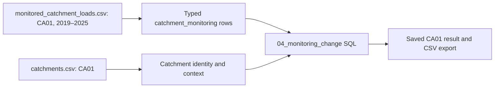

# Data lineage: source → model → result

Lineage answers three questions for this model:

1. **Where did it come from?** Full source path/hash, source locator and original values.
2. **What happened to it?** Column mappings, transformation register, scope rules,
   code/schema hashes, source-to-model links and model dependencies.
3. **Where was it used?** Recorded SQL executions, saved result rows and their
   contributing model records; dependency edges can be followed in either direction.

This is **conservative record-level lineage plus documented column rules**.
It does not claim automatic per-cell provenance for arbitrary SQL. A result's
ancestry can include fields unused by a particular expression because model rows
have broader dependencies. Catalogue SQL supplies the exact calculation.
Filtered-out records and absence of a matching report are not enumerated as positive
contributors; the full-file hash, query filter and build rules capture that context.

## Trace a real result

```bash
python3 tools/query_nature_model.py lineage 04_monitoring_change CA01 --output /tmp/ca01-lineage.json
```

The export includes the saved result, SQL and contributor SQL with hashes, build
version, entity graph, source files, raw source records, transformation descriptions
and applicable column rules. For this result:



The seven monitoring records support coverage counts and endpoint calculations.
They do not attribute the loads to Apetit. Geometry is not used by this query and
therefore does not appear in its ancestry.

## Inspect column mappings

Any SQLite client can run:

```sql
SELECT column_name, source_expression, rule
FROM column_lineage
WHERE table_name = 'farm_crop_observation'
ORDER BY column_name;
```

Original records are retained as strings for CSV fields, including decimal commas
and ja/nej. The typed model uses normalized numbers and 0/1 booleans. Raw GeoJSON
snapshots preserve parsed feature content; nonstandard NaN properties use explicit
tags described in [transformations](TRANSFORMATIONS.md). The file hash identifies
the original bytes; snapshots do not retain whitespace or original JSON formatting.

## Follow a result backwards in SQL

This example explains the sources of monitoring output for CA01. `UNION` removes
duplicate ancestors reachable through several paths.

```sql
WITH RECURSIVE ancestors(entity_id) AS (
    SELECT entity_id FROM query_result
    WHERE query_run_id = '04_monitoring_change:default' AND result_key = 'CA01'
    UNION
    SELECT d.parent_entity_id
    FROM record_dependency d JOIN ancestors a ON d.child_entity_id = a.entity_id
)
SELECT DISTINCT f.relative_path, f.sha256, r.locator, r.raw_json,
                t.transformation_id, t.description
FROM ancestors a
JOIN record_source s ON s.entity_id = a.entity_id
JOIN source_record r USING(source_record_id)
JOIN source_file f USING(source_id)
JOIN transformation t USING(transformation_id)
ORDER BY f.relative_path, r.locator;
```

CSV locators are `csv_line:<physical line>` with the header at line 1. Current
records occupy one physical line each. GeoJSON locators are zero-based JSON
pointers such as `/features/0`; `/crs` captures collection-level CRS metadata.
Raw IDs contain the full-file hash, so the same line in changed source contents
has a different source identity.

## Follow source usage forwards

This shows saved outputs downstream of the **first monitoring record** (line 2).
Change the source path/locator to inspect another record.

```sql
WITH RECURSIVE downstream(entity_id) AS (
    SELECT s.entity_id
    FROM record_source s JOIN source_record r USING(source_record_id)
    JOIN source_file f USING(source_id)
    WHERE f.relative_path = '06_nature/monitored_catchment_loads.csv'
      AND r.locator = 'csv_line:2'
    UNION
    SELECT d.child_entity_id
    FROM record_dependency d JOIN downstream p ON d.parent_entity_id = p.entity_id
)
SELECT DISTINCT q.query_run_id, q.result_key, q.values_json
FROM downstream d JOIN query_result q USING(entity_id)
ORDER BY q.query_run_id, q.result_key;
```

This is potential downstream impact in the recorded graph, not proof that changing
a source value would necessarily change a rounded output. It does not rerun a model.

## Granularity and lifecycle

- Domain records and geometry have natural keys represented as compact JSON arrays.
  Entity IDs combine table name and that key. Query output entities combine execution
  label and result key. Each database contains a single build snapshot.
- Sources used in full: all four farming files, master files, monitoring, indicators
  and geometry. Every supplied farming record across every year is snapshotted;
  complete original files are hashed. A field/year entity key includes its actual
  year; lineage never collapses repeated fields into one season.
- Area-discrepancy lineage includes all contributing peer field areas and peer crop
  assignments from the **same year**, because the diagnostic depends on a
  farm/crop/year area sum. Planned records have their own source lineage and no
  invented management report.
- Query contributor SQL is explicit and versioned. The builder checks every saved
  result has contributors; integration tests verify meaningful end-to-end paths.
  Adding a new query also requires contributor SQL and appropriate validation.
- Build/query timestamps are execution metadata. Result CSVs are reproducible from
  unchanged input/code, while database bytes and audit timestamps need not match.
- Rebuilding replaces this database's prior runs. Archive database and source versions
  for longitudinal audit; this is not an append-only production approval system.
- Original files must remain available to verify the full-file hashes. Code hashes
  identify implementations but do not embed their complete source in the database.
- These exploratory reports remain unreviewed; source lineage is not expert approval
  or evidence of scientific correctness.

## Investigation, climate and sourcing lineage

The independent `sources.sqlite` captures all selected records before typed
modelling and retains earlier file versions. Rejected model records remain
traceable by source hash and locator through `quarantine_record` and
`quality_evidence`. Matching source IDs connect the archive and model. Monthly
climate/grid/signal CSVs and focused ERP/material/supplier sources are included;
daily weather and other corporate feeds are not imported.

Weather exposure traces field/year → assumed static grid mapping → annual
grid/scenario/year → monthly records → original CSV. Mapping also traces the field
and chosen grid centre. Scenario stays in weather identities. Candidate-grid file
hash and algorithm identify the selection context; rejected candidates are not
positive lineage parents.

Sourcing results trace technical ERP records, material/supplier or farm resolution,
explicit crop mapping and reference FX assumption. Package code hashes identify
the mapping and reference-factor versions. Fixed FX assumptions are not observed
transaction-date rates. Findings link targets and comparison peers; ancestry is
conservative, not exact per-cell influence.

Parameterized queries record actual bound values, result pages, SQL versions and
contributors. Execution IDs distinguish later runs from build-time defaults.
All human review rows present at saved execution are copied into
`query_review_snapshot`; exports include this context. Later reviews do not
overwrite stored results or review snapshots. Direct SQLite writes are not
permission-controlled or tamper-proof; preserve a model before rebuilding if its
reviews, proposals or executions must be retained.

## Method evidence and nature-action screening

The model also captures complete master, scenario and framework package sources.
Local method documents use relative `../docs/` paths; no external URL content is
fetched. Full document snapshots are archived, while the analytical model
additionally stores exact heading/line-range slices.

`method_context` in lineage exports explains applicable table methods, their
implementation status and curated evidence roles. It includes exact local text,
document hashes and any external pointer/licence/verification status. This is
explanatory context, separate from computational record ancestry. The curated
knowledge map is versioned and hashed; a source pointer does not validate a method.

Action aggregates trace catchment/year/lever result → candidate fields → field/year
and screening rule → parcels, reports and raw lever catalogue. Rules and unmet
prerequisites come from the hashed action-screening config. Areas are assessment
leads, not estimated loads or efficacy. Pressure × state remains a planned method.
