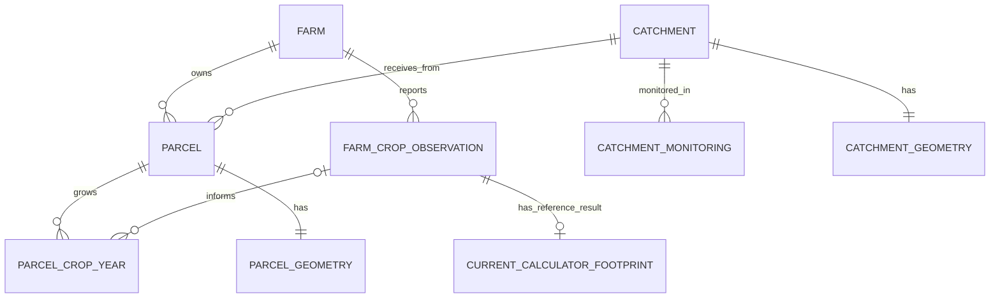
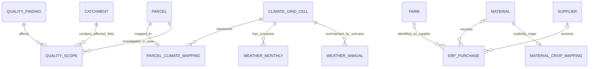

# Nature analytical model

Purpose: connect farming, receiving-water context, monitoring, climate and reported sourcing for
Track D exploration and data mining. The objective is to identify farming areas
for water and biodiversity assessment, explain evidence/uncertainty, and compare
possible actions. The database retains **all supplied farming
years**, **2019–2025 monitoring**, and the supplied static/latest master attributes.
No pollution estimation, imputation or final catchment ranking is performed.
All farming and geometry data is synthetic; results are not Apetit's actual impacts.

## Build and explore

From the model-package folder (`traceflow/nature_model/`), using Python 3.9+ with SQLite JSON functions available
(the current environment is verified):

```bash
python3 tools/build_nature_model.py
python3 -m unittest discover -s tools -p 'test_*.py'
python3 tools/query_nature_model.py list
python3 tools/query_nature_model.py query 01_contract_area
python3 tools/query_nature_model.py lineage 04_monitoring_change CA01 --output /tmp/ca01-lineage.json
```

Outputs:

- `analysis/nature/nature.sqlite`: rebuildable local database, ignored by Git.
- `analysis/nature/sources.sqlite`: durable source archive, including older captured versions.
- [Query results](../../analysis/nature/queries): twenty-two CSVs, one per documented question.
- [Validation report](../../analysis/nature/validation.json): counts and integrity checks.
- Exported lineage JSON: a selected result's query, dependencies, transformations,
  original source records and file hashes.

The builder captures original records first, then applies typed lookups and the
shared farming observation normaliser. It does not depend on the generated 2025
farming CSV. That CSV remains a separate, focused export.
It leaves original files unchanged. The database is built in a temporary file and
replaces the destination after validation. Rebuilding replaces prior results and
audit history in that database: preserve a copy if you need multiple runs.
`--data-dir`, `--database` and `--output-dir` support separate build destinations.
`--stage quality|climate|sourcing|masters|frameworks|decisions` selects cumulative
build stages; default `decisions` includes all six in that order. Use separate
output paths for stage experiments.
The database starts with one build and one default execution of each catalogue query.
Parameters are validated and bound; `--save` records an additional run, results,
review-state snapshot and contributors. Without it queries are read-only.
Custom SQL must be registered with contributor logic to gain
the same result-level audit trail; arbitrary SQL is not automatically traced.

## Relationships



The last two relationships are complete in this package. Geometry is linked by
the supplied IDs. No point-in-polygon join or reassignment is performed: synthetic
shapes may not coincide with supplied catchment assignments or real hydrology.
GeoJSON is stored as ordinary text, not a spatial database extension. CRS is
**OGC CRS84 (WGS84 longitude, latitude order)**, as declared in both source files.
Simple polygon ring/bounds checks are performed; full topology validity and
spatial indexing are not implemented. Degrees are unsuitable for area/distance
calculations without projection or an appropriate geodesic method.

`origin_nature_indicator` is retained separately for later Track D2 screening.
It is country/commodity context, not a catchment biodiversity measurement. No
automatic mapping of its broad commodity labels to ERP materials is assumed.

The additional relationships are:



## Time coverage and filtering

| Table | Rows | Years / status |
|---|---:|---|
| `parcel_crop_year` | 284,260 | Declared 2012–2026; planned 2027–2031 |
| `farm_crop_observation` | 6,120 | Finland 2012–2026; Sweden 2018–2026 |
| `current_calculator_footprint` | 3,437 | Finnish farm/crop results, 2012–2026 |
| `catchment_monitoring` | 105 | 2019–2025 |
| `weather_monthly` | 139,104 | Historical 1991–2026; three SSPs 2027–2060 |
| `weather_annual` | 11,592 | Annual and Apr–Sep summaries, scenario retained |
| `erp_purchase` | 7,427 | Posting years 2021–2025; signed returns retained |

Use **`field_context`** for unrestricted exploration. Year selection belongs in
the query, not the ingestion pipeline:

```sql
-- Actual declared crop assignments for a chosen year.
SELECT parcel_id, farm_id, year, crop, area_ha, catchment_id, observation_id
FROM field_context
WHERE year = 2025 AND crop_status = 'declared';

-- Crop area over time. This describes land allocation, not delivered production.
SELECT year, crop_status, crop, ROUND(SUM(area_ha), 2) AS mapped_area_ha
FROM field_context
WHERE is_contract_crop_provisional = 1
GROUP BY year, crop_status, crop
ORDER BY year, crop;

-- Field history, with reports matched only to their own crop and year.
SELECT parcel_id, year, crop_status, crop, observation_id, reported_p_kg_ha
FROM field_context
WHERE parcel_id = 'F0001-P09'
ORDER BY year;
```

Questions 01/02 accept a year parameter (default 2025); 04 compares 2019 and 2025.
New questions cover multi-year coverage, quality, history, weather and sourcing.
They also expose master references, method evidence, scenarios, dated events and
unreviewed nature-action screening leads. See the [decision-context guide](DECISION_CONTEXT.md).
`field_context_2025` remains a compatibility
view defined as `SELECT * FROM field_context WHERE year = 2025`. It does not limit
the underlying tables. Custom queries do not automatically create saved lineage;
see the catalogue instructions for registering an auditable question.

Repeated field area across years must not be summed and labelled unique hectares:
group by year or call the result hectare-years. Planned assignments are not actual
observations. No earlier management report is carried forward into a future plan.
Reference carbon footprints retain their source method and exclusions and are not
nutrient-loss observations or recalculated emissions.

## Read these documents together

1. [Data dictionary](DATA_DICTIONARY.md): grains, keys, types, units, missing values.
2. [Transformations and assumptions](TRANSFORMATIONS.md): exact modelling choices.
3. [Query catalogue](QUERY_CATALOG.md): questions, calculations and safe aggregation.
4. [Data lineage](LINEAGE.md): how to follow a result back to the source.
5. [SQL schema](schema.sql): executable table constraints, indexes and field view.
6. [Data-quality rules and workflow](DATA_QUALITY.md): findings, evidence, source archive and corrections policy.
7. [Climate and sourcing](CLIMATE_AND_SOURCING.md): spatial mapping, weather features, ERP units and reference assumptions.
8. [Parameterized query contracts](API_QUERY_CONTRACTS.md): filters, output grain, pagination, saved runs and API/MCP use.
9. [Extension schema](extensions.sql): quality, climate, sourcing and query-definition tables/views.
10. [Decision context](DECISION_CONTEXT.md): master completion, framework evidence, scenarios, action-screening rules and limitations.
11. [Decision-context schema](decision_context.sql): executable reference, knowledge, scenario and action tables.

## Reliability and data-mining boundaries

- SQLite `REAL` uses binary floating point. Raw source strings and the existing
  Decimal-based farming CSV preserve original precision; SQL area outputs round
  only after aggregation. This is an exploratory analytical database.
- `NULL` means unknown/unavailable. Zero N application is a real reported value.
  Monitoring absence is not zero pollution.
- There are no validated field-level nutrient losses, species observations or
  biodiversity outcome labels. Nutrient pressure, ecological status and indicator
  categories must not be presented as measured biodiversity effects.
- Current selection matches annual crop to the farm registry's **static** list.
  Twenty-three farm lists are blank. `field_context.contract_selection_status`
  marks these `unknown_contract_list`; their provisional selection flag remains 0.
  Excluded fields are not confirmed to be outside annual sourcing.
- Farm ownership, field attributes and contract-crop lists are static/latest
  snapshots. Applying them to past seasons or future plans is an explicit
  assumption, not evidence of historical ownership or future contracts.
- Data gaps, outliers and reconciliation findings remain unreviewed. Structurally
  invalid or duplicate domain records are quarantined with evidence. Detection
  does not establish correctness of accepted values.
- Field/year rows share fields, farm-level observations and catchments. They are not independent
  samples. For later ML, group evaluation by farm/catchment and time as appropriate;
  avoid leaking repeated reports between training and evaluation sets.
- Six Track D development answers are deliberately **not imported as features**.
  They can later be a separate calibration/evaluation dataset with explicit use
  recorded. Monitoring loads include background and non-contract farmland.

Provisional [input policies](NUTRIENT_MODEL_INPUT_POLICY.md) and a separate
[field-loss pilot](NUTRIENT_LOSS_METHOD.md) now exist. The pilot preserves
missingness and source evidence, uses historical weather and separates field
loss, distance delivery and retention. Its modifiers are explicit assumptions;
the next scientific work is justifying/calibrating them and evaluating against
independent evidence with non-contract/background boundaries. No nutrient-loss
model, action efficacy or final catchment ranking has been scientifically validated.
